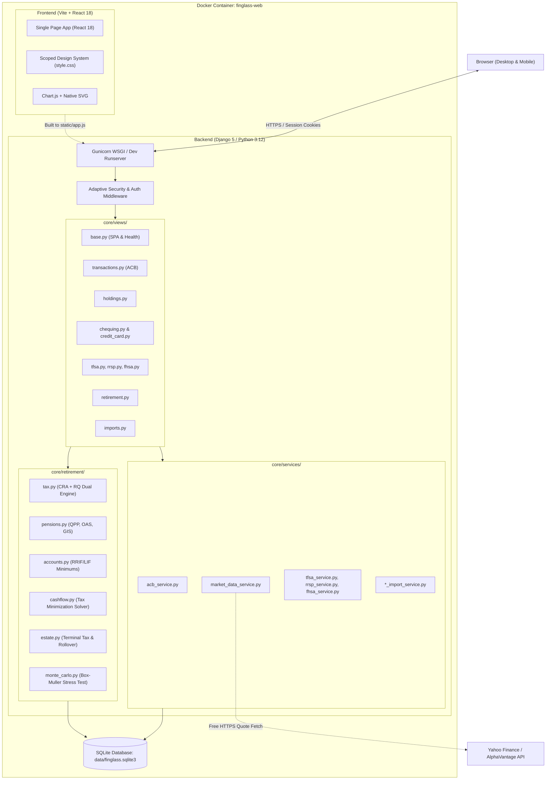

# FinGlass System Architecture

FinGlass is a single-tenant personal wealth intelligence system engineered for Canadian investors and retirees, with specialized support for Quebec statutory tax, pension, and estate optimization.

---

## 1. High-Level Topology

FinGlass runs as a containerized full-stack web application with a modern decoupled architecture:



---

## 2. Directory Structure

```
FinGlass/
├── accounts/                 # User authentication & RBAC
│   ├── models.py             # Custom User model & Admin action logs
│   ├── views.py              # Login, register, setup, session check
│   └── urls.py               # /api/auth/* endpoints
├── config/
│   └── tax_constants_qc_2026.json # Externalized Quebec & CRA tax constants
├── core/
│   ├── admin.py              # Django admin registrations
│   ├── apps.py               # Core application configuration
│   ├── constants.py          # Supported types, cash account constants
│   ├── middleware.py         # Login enforcement, CSRF, security headers
│   ├── models.py             # Portfolio, banking, tax shelter & retirement models
│   ├── tests.py              # Comprehensive backend unit test suite
│   ├── urls.py               # Main URL dispatcher & SPA fallback routing
│   ├── management/           # Commands (seed_demo_data.py)
│   ├── migrations/           # Versioned SQLite migrations
│   ├── retirement/           # Quebec statutory retirement engine (Modules 1–11)
│   │   ├── accounts.py       # Statutory account state & RRIF/LIF minimum formulas
│   │   ├── cashflow.py       # Annual cash flow solver & tax-efficient sequencing
│   │   ├── config.py         # Statutory inflation indexing loader
│   │   ├── engine.py         # Deterministic multi-year simulation runner
│   │   ├── estate.py         # Deemed disposition, terminal taxes & spousal rollover
│   │   ├── models.py         # Strongly-typed dataclasses for household & plan
│   │   ├── monte_carlo.py    # Multi-path sequence of returns stochastic engine
│   │   ├── pensions.py       # QPP/RRQ, OAS, and GIS statutory formulas
│   │   ├── tax.py            # CRA + Revenu Québec 2026 progressive bracket solver
│   │   └── tests.py          # Retirement engine verification test suite
│   ├── services/             # Pure reusable business logic & import parsers
│   │   ├── acb_service.py    # Rolling Weighted Average Cost (ACB) calculator
│   │   ├── chequing_service.py
│   │   ├── credit_card_categories.py
│   │   ├── credit_card_service.py
│   │   ├── fhsa_import_service.py
│   │   ├── fhsa_service.py
│   │   ├── holdings_service.py
│   │   ├── market_data_service.py
│   │   ├── room_status.py
│   │   ├── rrsp_import_service.py
│   │   ├── rrsp_service.py
│   │   ├── settings_service.py
│   │   ├── tfsa_import_service.py
│   │   ├── tfsa_service.py
│   │   └── transactions_service.py
│   └── views/                # Modular view handlers
│       ├── __init__.py       # Re-exports all view callables
│       ├── base.py           # Single Page App index renderer & health view
│       ├── chequing.py       # Chequing account CRUD & transaction analytics
│       ├── credit_card.py    # Credit card CRUD, filters & recategorization
│       ├── fhsa.py           # First Home Savings Account limits & transactions
│       ├── holdings.py       # Holdings positions, cash account & quote refresh
│       ├── imports.py        # Import wizard, staged reviews, and export endpoints
│       ├── net_worth.py      # Net worth history CRUD
│       ├── retirement.py     # Retirement planning, simulation, & CSV export
│       ├── rrsp.py           # RRSP limits, transactions & contribution room
│       ├── settings.py       # App feature settings
│       ├── tfsa.py           # TFSA limits, transactions & room calculation
│       └── transactions.py   # ACB transaction ledger CRUD
├── data/
│   └── finglass.sqlite3      # Persistent SQLite database file
├── docs/                     # Specifications, guides, and manuals
│   ├── API.md                # Full REST API Reference
│   ├── ARCHITECTURE.md       # Technical architecture specification
│   ├── IMPORT_GUIDE.md       # CSV & statement import guide
│   ├── RETIREMENT_ENGINE.md  # Quebec statutory retirement engine manual
│   ├── SPEC.md               # IPF 2026 Quebec retirement engine specification
│   └── TAX_SHELTERS.md       # Canadian registered accounts guide
├── finglass_project/         # Django core settings, WSGI, ASGI
├── frontend/                 # React 18 frontend source code
│   ├── src/
│   │   ├── App.jsx           # Root application shell, navigation, & auth state
│   │   ├── api.js            # Standardized fetch API wrapper
│   │   ├── components/       # Shared UI widgets, charts, and modal components
│   │   ├── utils/            # Formatters, currency helpers, and date filters
│   │   └── views/            # 14 modular React views
│   ├── index.html            # Vite HTML template
│   ├── package.json          # Node dependencies
│   └── vite.config.js        # Vite bundler configuration
├── static/                   # Compiled CSS/JS production artifacts
├── templates/
│   └── index.html            # Django SPA entrypoint template
├── Dockerfile                # Multi-stage production build (Node 26 + Python 3.12)
├── docker-compose.yml        # Local development & production deployment stack
└── manage.py                 # Django CLI management entrypoint
```

---

## 3. Frontend Architecture

- **Framework:** React 18 with functional components and native hooks (`useState`, `useEffect`, `useMemo`, `useCallback`).
- **Tooling:** Vite 5 compiling cleanly to a unified `static/app.js` and `static/app.css`.
- **Styling:** Custom, themeable dark-mode design system with pure CSS variables (`--bg-primary`, `--accent-primary`, etc.), zero heavy CSS frameworks, and instant render performance.
- **Visualizations:** Chart.js 4 + native Canvas and inline SVG gauges.
- **Accessibility & Senior Mode:**
  - Standard Mode: Detailed tabular audits, tax brackets, KPI metrics, Monte Carlo charts.
  - Senior / "Brain-Dead Easy" Mode: Large typography, conversational plain-English status banners ("Safe Until Age 95+"), green/amber/red indicators, and 3 plain-English action recommendations.

---

## 4. Backend Architecture

### Request Lifecycle
1. **Entrypoint:** Handled by Gunicorn in production or Django's development server.
2. **Middleware Pipeline:**
   - `WhiteNoiseMiddleware`: Direct, zero-config static asset serving with cache headers.
   - `AdaptiveCookieSecurityMiddleware`: Dynamically matches cookie `Secure` flags to whether incoming traffic is HTTP or HTTPS.
   - `CsrfViewMiddleware` & `SecurityHeadersMiddleware`: Enforces CSRF tokens, strict CSP, X-Frame-Options (`DENY`), and nosniff headers.
   - `LoginRequiredMiddleware`: Protects all private routes while keeping `/login`, `/api/auth/*`, and `/__django__/health/` accessible.
3. **Routing:**
   - `/api/*`: Explicitly routed to domain view functions in `core/views/` or `accounts/views.py`.
   - `/__django__/health/`: Zero-auth health probe for load balancers.
   - `re_path(r"^(?!api/|admin/|static/).*$", index_page)`: Passes all frontend URL paths to React Router / SPA navigation.

---

## 5. Security & Isolation

- **Zero Outside Analytics:** No external tracking, telemetry, or remote analytics scripts are loaded.
- **Content Security Policy (CSP):** Strict allowlist configured in `core/middleware.py`.
- **Local SQLite Storage:** All financial data remains on the user's host machine inside the Docker volume `./data:/app/data`.
- **Role-Based Access Control:** Superuser flags control access to user management, feature toggles, and administrative data wiping.
