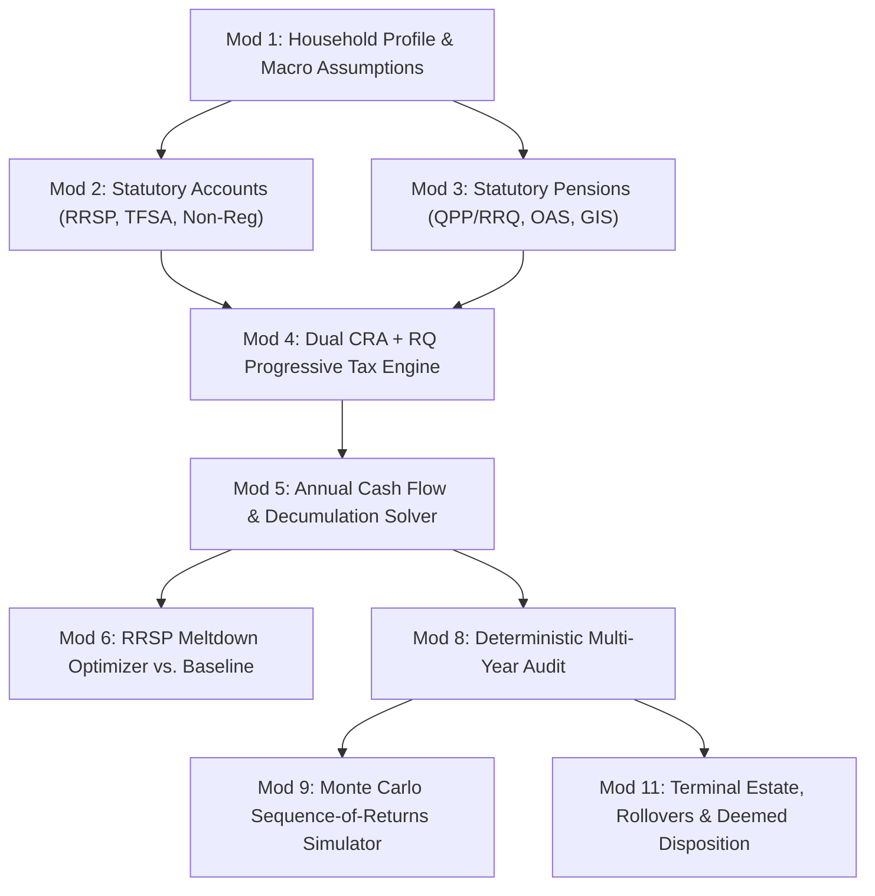

# Quebec Statutory Retirement & Estate Planning Engine

FinGlass includes a calculation engine tailored to the statutory tax, pension, and estate rules of **Quebec, Canada** (Base Year: **2026**).

---

## 1. Engine Modules Architecture

The engine is located in [`core/retirement/`](file:///home/gabriel/FinGlass/core/retirement/) and implements 11 specialized modules:



---

## 2. Statutory Pensions (Module 3)

### Quebec Pension Plan (QPP / RRQ)
- **Normal Retirement Age:** 65.
- **Early Withdrawal (Age 60 to 64):** Reduced by **0.6% per month** (7.2%/year) prior to age 65 (up to -36% at age 60).
- **Postponed Withdrawal (Age 66 to 72):** Increased by **0.7% per month** (8.4%/year) after age 65 (up to +58.8% at age 72).
- **Work-Retirement Benefit:** Earned income while receiving QPP accrues additional retirement pensions.

### Old Age Security (OAS / SV)
- **Start Age:** 65 to 70 (+0.6%/month enhancement for each month delayed past 65).
- **Residency Requirement:** Scaled by $\min(1.0, \text{YearsInCanada} / 40)$.
- **OAS Pension Recovery Tax (Clawback):**
  - Clawback threshold: **\$90,997** (2026 base, indexed annually by inflation $i$).
  - 15% recovery tax on Net World Income exceeding the threshold.

### Guaranteed Income Supplement (GIS / SRG)
- Nontaxable monthly benefit for low-income seniors.
- Fully phased out as family net income increases.

---

## 3. Dual-Tax Engine: CRA & Revenu Québec (Module 4)

Federal and Quebec provincial tax calculations are evaluated simultaneously:

```
Total World Income
  - RRSP / Deductions
= Net World Income (Used for OAS Clawback)
  - Non-Capital Losses / Capital Gains Exemption
= Taxable Income
```

### Statutory Brackets & Rates (2026 Base)

| Federal Brackets (Indexed) | Rate | Quebec Brackets (Indexed) | Rate |
| :--- | :--- | :--- | :--- |
| Up to \$55,867 | 15.0% | Up to \$51,780 | 14.0% |
| \$55,867 – \$111,733 | 20.5% | \$51,780 – \$103,545 | 19.0% |
| \$111,733 – \$173,205 | 26.0% | \$103,545 – \$126,000 | 24.0% |
| \$173,205 – \$246,752 | 29.0% | Over \$126,000 | 25.75% |
| Over \$246,752 | 33.0% | — | — |

### Key Credits & Adjustments
- **Federal Quebec Abatement:** 16.5% reduction of Basic Federal Tax for Quebec residents.
- **Age Credit (Federal & Quebec):** Indexed credit for individuals aged 65+, clawed back above threshold.
- **Pension Income Tax Credit:** Up to \$2,000 federal (15%) and \$3,071 Quebec (14%) on eligible pension income.
- **RAMQ Prescription Drug Insurance:** Mandatory provincial premium for individuals without private employment drug insurance.
- **Quebec Home-Support Tax Credit:** 35% refundable credit for seniors aged 70+ living independently.
- **Pension Income Splitting:** Up to 50% of eligible pension income transferred between spouses to equalize marginal brackets (Form T1032 / Schedule Q).

---

## 4. Accounts & Decumulation Ordering (Module 5 & 6)

### Conversion to RRIF & LIF
- At age 71, RRSPs must convert to a Registered Retirement Income Fund (RRIF / FERR).
- LIRAs convert to a Life Income Fund (LIF / FRV), subject to mandatory annual minimums and provincial maximum caps.

### Optimal Withdrawal Ordering
1. **Mandatory Inflows First:** Employment, QPP, OAS, DB Pension, RRIF/LIF minimums.
2. **Tax-Efficient Filling:** Withdraw from Non-Registered accounts up to lower bracket limits.
3. **RRSP Meltdown:** Systematically melt down RRSP/RRIF balances prior to age 71 to prevent massive tax spikes and OAS clawbacks at age 72+.
4. **TFSA Last:** Preserved for tax-free compounding and unexpected liquidity shocks.

---

## 5. Monte Carlo Sequence-of-Returns Simulator (Module 9)

To ensure solvency is not merely a product of constant average returns, the engine runs 1,000 randomized stochastic trials:
- **Normal Random Generation:** Box-Muller transform:
  $$Z = \sqrt{-2 \ln(U_1)} \cos(2\pi U_2)$$
- **Asset Allocation Modeling:** Weights assigned to Cash, Fixed Income, Canadian, US, and International Equities.
- **Percentile Trajectories:** Returns trajectories across P10 (Pessimistic), P50 (Median), and P90 (Optimistic).
- **Probability of Success:** Defined as the fraction of trials where total net wealth remains positive throughout the retiree's life expectancy.

---

## 6. Senior & Retiree Mode ("Brain-Dead Easy")

FinGlass provides a toggleable **Senior Mode** designed specifically for users who want answers without financial jargon:
1. **Plain-English Health Banner:**
   - 🟢 "Safe until Age 95+ (Fully Funded Plan)"
   - 🟡 "Attention: Deficit may appear around Age 86"
   - 🔴 "Shortfall Warning: Capital depleted before life expectancy"
2. **Key Metric Tiles:**
   - "Your Monthly Spending Money" (Net of all taxes)
   - "Lifetime Taxes & Government Clawbacks"
   - "Leftover for Family / Estate"
3. **Plain-English Action Checklist:** 3 high-impact recommendations (e.g. "Delay QPP to Age 68 to gain \$312/mo permanently", "Melt down \$14,000/yr from RRSP now to protect OAS").

